

[](https://github.com/marcuspat)

**Los Angeles, CA · Principal Agentic Engineer**

I build autonomous multi-agent systems that let one engineer ship like a team.

`Autonomous Agent Orchestration` · `Multi-Agent Swarm Coordination` · `Cloud-Native Infrastructure` · `Rust Systems Tooling`

[Entry points](#choose-your-entry-point) · [Turbo Rig](#the-turbo-rig-stack) · [Turbo-Flow Stack](#the-turbo-flow-stack) · [SaaS](#saas-in-production---real-estate-intelligence--ai-enhanced-functionality) · [Developer Tooling](#developer-tooling) · [Rust Crates](#published-rust-crates) · [Technical Reviews](#technical-reviews) · [Organizations](#organizations)

[Ecosystem sites](#ecosystem-sites): Adventure Wave Labs · Turbo Flow · Turbo Rig · Agentic Platform Engineering · Adventure on the Wave · Creando Tu Matrix · Ancuria

---

## Choose your entry point

  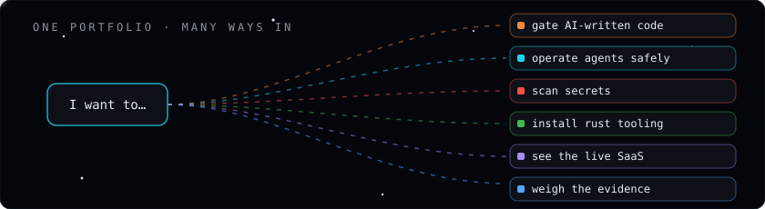

One portfolio, many ways in — start with the problem you want to solve. Every "Start here" is something you can actually open: a public repo, a live site, or a `cargo install`.

| I want to… | Start here | Then explore |
|---|---|---|
| Keep AI-written code out of `main` unreviewed | [**turbo-flow**](https://github.com/marcuspat/turbo-flow) — a developer tool: the rules layer with a fail-closed review gate cross-checked across model families, a written constitution, git-versioned memory | [turbo-rig.com](https://turbo-rig.com) — the successor rig (private beta) |
| Let an agent operate a real system safely | [**Sentinel**](https://github.com/marcuspat/Sentinel) — Investigate → Plan → Approve → Act under a deny-by-default policy, with an operator gate and a hash-chained audit log | [codescope](https://github.com/adventurewave-labs/codescope) — the repo as a queryable graph, so the agent reads before it writes |
| Stop secrets before they ship | [**secret-scan**](https://github.com/adventurewave-labs/secret-scan) — 50 patterns, entropy and obfuscation detection, `cargo install secretscan` | [cargocrypt](https://github.com/marcuspat/cargocrypt) · [the Homebrew tap](https://github.com/marcuspat/homebrew-tap) |
| Install the Rust tooling | [**cargo-forge**](https://github.com/marcuspat/cargo-forge) — `cargo install cargo-forge`, 7 typed templates | [all 7 crates](#published-rust-crates) · [netrain](https://github.com/marcuspat/netrain) · [rustops](https://github.com/marcuspat/rustops) |
| See a real product in production | [**ancuria.com**](https://ancuria.com) — bilingual real-estate SaaS: Mexican payments end-to-end, AI listing drafts, RADAR quotes | [the technical deep-dive](https://ancuria-deep-dive.vercel.app) |
| Judge the operation by its evidence | [**Packt technical reviews**](#technical-reviews), 2021–2026 — seven titles reviewed across Rust, Go, Python and AI tooling | [the lab](#lab--demos) — deployed demos, not screenshots |
| Hire me | [**adventureonthewave.com**](https://www.adventureonthewave.com) — paid agentic AI & platform engineering sessions | [LinkedIn](https://linkedin.com/in/marcuspatman) · [marcuspatman.space](https://marcuspatman.space) |

`Gate` · `Map` · `Remember` · `Ship` · `Operate` — gate the diff (turbo-flow), map the codebase (codescope), remember across sessions (turbo-brain v2), ship the tool (7 crates), operate the product (Ancuria).

  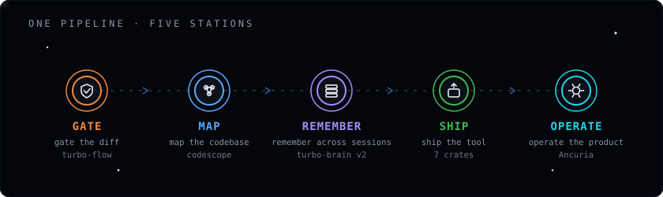

---

  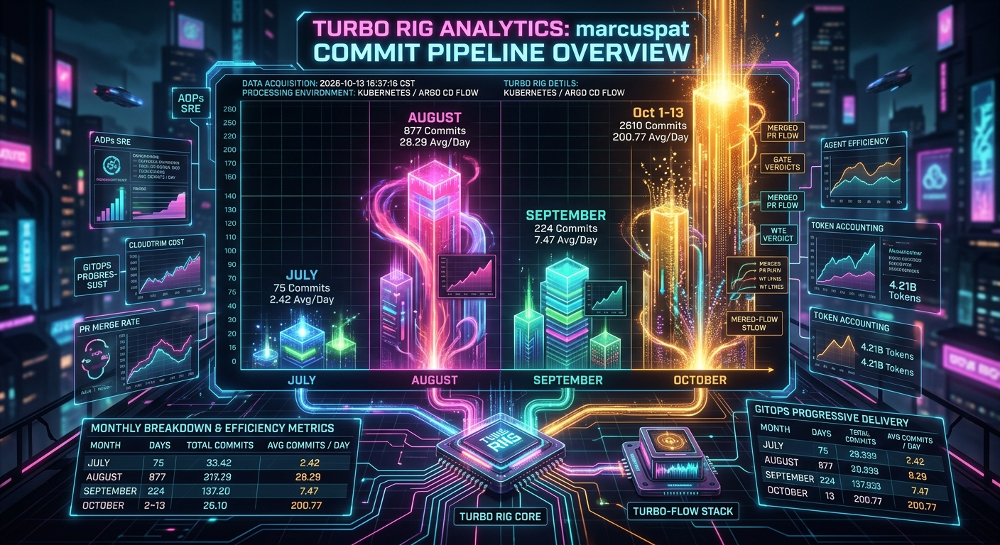

## The Turbo Rig Stack — A DevOps Tool for AI Coding Agents

  

Turbo Rig is a **DevOps tool for AI coding agents** — it runs coding agents the way production is already run: a cross-model review gate as the pipeline check, merges held by humans, secrets in the keychain, scheduled automations, and state in git. The successor to Turbo Flow — not more agents, but the harness that governs them: **Triangle + Spine + Loop**. Swappable lanes (builder / reviewer / reserve) under one shared constitution, a review gate **cross-checked across model families** with fail-closed verdicts, worktree isolation for parallel writers, git-versioned cross-session memory — and the merge button always in human hands.

| Tool | Stars | Lang | Purpose |
|---|---|---|---|
| [**turbo-rig**](https://github.com/marcuspat/turbo-rig) | — | Shell / Python | The full rig — a DevOps tool for AI coding agents: an eleven-law constitution, `review.sh` — the review gate with token accounting, `wt.sh` worktrees, `secret.sh` keychain, git-versioned `memory/`, scheduled automations, specs and runbooks. One command installs and wires it all. *Private repo — beta.* |
| [**rust-utils**](https://github.com/marcuspat/turbo-rig/tree/main/rust-utils) | — | Rust | The rig's Rust edge tools — one binary per problem, the working bash cores untouched: `gate-run` (the push runs inside the verdict, so a pipe can never ship a REVISE), `strand` (read-only detector for commits stranded by early merges — merge-commit and squash aware), and `bead` (a SQLite bead queue with token-bound atomic claims and bounded retries). *In the private turbo-rig repo.* |
| [**Turbo Brain v2**](https://github.com/adventurewave-labs/turbo-brain-v2) | — | Python / Shell | The rig's memory plane — an owned context vault: plain markdown in git, served read-only over MCP so a session starts with the context it needs instead of asking for it. Capture is a pure text PUT; schema lint, secret scan, client deny-list and agent-poison tripwires gate what enters, and budget-capped distill waves land as PRs under a protected main. *Private repo — v1.2.0.* |
| [**turbo-rig.com**](https://turbo-rig.com) | — | — | The product page: the full methodology — why builder ≠ reviewer, the three execution planes (laptop / VPS / Codespaces), and the eight-station loop that ends in a human merge. |
| [**Deep-dive**](https://turbo-rig-deep-dive.vercel.app) | — | — | Technical walkthrough with 11 SVG diagrams — triangle, spine, planes, and loop, section by section. |
| [**Deep-dive 3D**](https://turbo-rig-deep-dive-3d.vercel.app) | — | — | The same architecture as an explorable 3D scene — the loop, the triangle, the gate, the data gravity well, the planes, and the automation ring. |

---

## The Turbo-Flow Stack — A Developer Tool for AI-Written Code

  

| Tool | Stars | Lang | Purpose |
|---|---|---|---|
| [turbo-flow](https://github.com/marcuspat/turbo-flow) |  | Shell / Python | A developer tool — the rules layer for AI-written code (rig-lite): a fail-closed cross-model review gate, a written constitution, git-versioned memory, worktree isolation, secrets. Any harness, any repo. v1–4 were the agentic dev environment — 215+ MCP tools via [Ruflo v3.5](https://github.com/ruvnet/ruflo) by [ruvnet](https://github.com/ruvnet). Site: [turboflow.online](https://www.turboflow.online) |
| [turbo-flow-wizard](https://github.com/adventurewave-labs/turbo-flow-wizard) |  | Shell | Guided Interactive generator for project-specific CLAUDE.md configs. 12 app types, 7 methodologies, 19 feature sets. |
| [loopgen](https://github.com/adventurewave-labs/loopgen-rs) |  | Rust | Agentic loops for Claude Code — wizard, TOML configs, bash export, LOOP_STATUS protocol. Published on [crates.io](https://crates.io/crates/loopgen). |
| [turbo-brain-v2](https://github.com/adventurewave-labs/turbo-brain-v2) | — | Python / Shell | Owned knowledge vault for the agent stack — plain markdown in git, served read-only over MCP (`brain_search`, `brain_context`, `brain_verify`) to Claude Code, Cowork and Turbo Rig. Daily no-model triage, weekly budget-capped distill, monthly sweeps; every fact carries provenance citations agents can re-verify. *Private repo — v1.2.0.* |

### In motion

|  |  |
|:---:|:---:|
| *turbo-flow — real install, real tmux workspace, real claude launch* | *turbo-flow-wizard — interactive CLAUDE.md generator* |

|  |
|:---:|
| *loopgen — agentic loops for Claude Code: wizard, TOML, bash export* |

---

## SaaS in Production - Real Estate Intelligence & AI Enhanced Functionality

Not just infrastructure — I ship complete products. [**Ancuria**](https://ancuria.com) is a real-estate intelligence SaaS I built and operate in production for the Mexican market: subscription billing with Mexican payments end-to-end (card, SPEI, and cash via Conekta, plus CFDI invoicing), multi-tenant team management with role-based access control, a three-level AI assistant that drafts listings in Spanish and English and answers client chats, RADAR — four financial calculators over 45+ daily market indicators — and a CRM that fills itself while agents sell. Bilingual (ES/EN), installable PWA, dark mode, web push. Free tier with unlimited listings; paid plans $249–$699 MXN/month.

| Tool | Stars | Lang | Purpose |
|---|---|---|---|
| [**ancuria.com**](https://ancuria.com) | — | — | The live product — registrations, listings, AI assistant, RADAR quotes, and payments in production. *Private codebase — 399 merged PRs as of Sept 2026.* |
| [**Deep-dive**](https://ancuria-deep-dive.vercel.app) | — | — | Technical walkthrough: publish once → the agent network → AI descriptions → RADAR quotes → close. |
| [**Deep-dive 3D**](https://ancuria-deep-dive-3d.vercel.app) | — | — | The platform as an explorable 3D scene. |
| [**ChatGPT plugin**](https://chatgpt.com/plugins/plugin_asdk_app_6add634eed0481919dbf3a1a5b6a26c8) | — | — | Ancuria's MCP tools, published in the ChatGPT plugin directory — property and market data answered inside ChatGPT. |

### In motion

*Ancuria — a brand-new user on the live product: login, listing detail, Market Intelligence, the RADAR payment-plan quoter, plans*

Next.js 16 · React 19 · Prisma · PostgreSQL · Conekta · Banxico

---

## Developer Tooling

  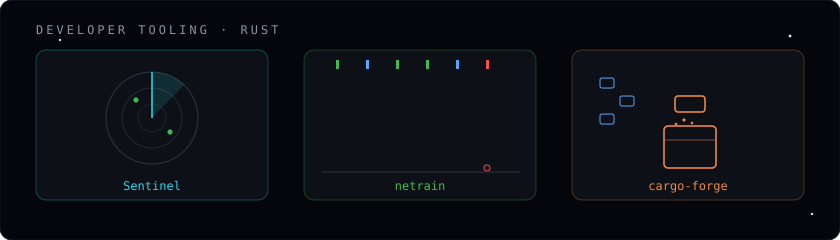

| Tool | Stars | Lang | Purpose |
|---|---|---|---|
| [cargo-forge](https://github.com/marcuspat/cargo-forge) |  | Rust | Rust project generator — 7 typed templates: CLI, API server, WebAssembly, game engine, embedded. |
| [netrain](https://github.com/marcuspat/netrain) |  | Rust | Matrix-style network packet monitor — real-time DDoS and port-scan detection in the terminal. |
| [Sentinel](https://github.com/marcuspat/Sentinel) |  | Rust | Safe agentic sysadmin — file operations, process control, network inspection with human-in-the-loop guardrails. |

### In motion

*netrain — live packet monitor with threat detection*

|  |  |
|:---:|:---:|
| *Sentinel — safe agentic sysadmin* | *cargo-forge — interactive Rust project generator* |

More tooling — `secret-scan`, `codescope`, and the rest of the lab — lives at [adventurewave-labs](https://github.com/adventurewave-labs).

---

### Lab / Demos

  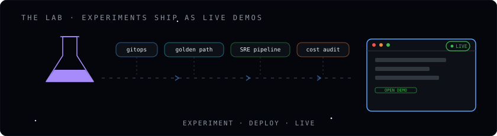

Experiments, proofs of concept, and agentic demos.

| Repo | What it explores |
|---|---|
| [agentic-powered-golden-path-demo](https://github.com/adventurewave-labs/agentic-powered-golden-path-demo) | NL → GitOps deployment via golden-path workflows (ArgoCD + OpenRouter) |
| [AI-Kubernetes-API-Generator-Demo](https://github.com/adventurewave-labs/AI-Kubernetes-API-Generator-Demo) | NL → Kubernetes API generation |
| [agentic-devops-extravaganza](https://github.com/adventurewave-labs/agentic-devops-extravaganza) · [live demo](https://agentic-devops-extravaganza.vercel.app/) | Working demo of K8sGPT and Robusta running against a real Kubernetes API + GLM-4.5 LLM |
| [agentic-platform-engineering-extravaganza](https://github.com/adventurewave-labs/agentic-platform-engineering-extravaganza) · [live demo](https://agentic-platform-engineering-extravaganza.vercel.app/) | Golden path + Score → Crossplane + real OPA policy gates + an authz-gated MCP server — 42 policy violations without a platform, 0 with one |
| [aops-sre-pipeline](https://github.com/adventurewave-labs/aops-sre-pipeline) · [live demo](https://aops-sre-pipeline.vercel.app/) | Alert-driven autonomous SRE pipeline — Prometheus → n8n → Popeye → Dify-lite → Ollama → Slack |
| [gitops-progressive-delivery-demo](https://github.com/adventurewave-labs/gitops-progressive-delivery-demo) · [live demo](https://gitops-progressive-delivery-demo.vercel.app/) | Argo CD + Argo Rollouts + Prometheus + K8sGPT progressive delivery — a canary trips an SLO violation, an AI SRE diagnoses it, and the rollout auto-rolls back in ~20s |
| [moor](https://github.com/adventurewave-labs/moor) · [live demo](https://moor-devops-demo.vercel.app) | Desired-state control plane for docker-compose — OBSERVE → DIFF → PLAN → ACT drift detection with real auto-remediation against the live Docker Engine API |
| [cloudtrim](https://github.com/adventurewave-labs/cloudtrim) · [live demo](https://cloud-trim-demo.vercel.app/) | 22-rule AWS cost-waste audit & remediation engine — read-only scan, verified fixes, and CUR-reconciled savings reporting demoed against a pinned AWS API emulator |

---

## Published Rust Crates

  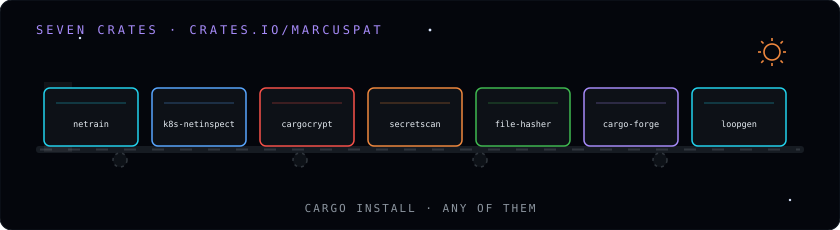

7 crates on crates.io — download counts below update automatically.

### Networking & Observability

| Crate | Downloads | Purpose |
|---|---|---|
| [netrain](https://crates.io/crates/netrain) |  | Matrix-style network packet monitor with IP tracking and threat detection |
| [k8s-netinspect](https://crates.io/crates/k8s-netinspect) |  | Minimal Kubernetes network inspection — CNI and pod connectivity |

### Security & Cryptography

| Crate | Downloads | Purpose |
|---|---|---|
| [cargocrypt](https://crates.io/crates/cargocrypt) |  | Zero-config cryptographic operations for Rust projects |
| [secretscan](https://crates.io/crates/secretscan) |  | Blazing-fast secret scanner for codebases -- AWS keys, GitHub tokens, API secrets |

### Utilities

| Crate | Downloads | Purpose |
|---|---|---|
| [file-hasher](https://crates.io/crates/file-hasher) |  | Fast SHA256 / SHA1 / MD5 file hashing CLI with progress output |
| [cargo-forge](https://crates.io/crates/cargo-forge) |  | Rust project generator -- 7 typed templates for CLI, API server, WebAssembly, game engine, embedded |

### Agent Tooling

| Crate | Downloads | Purpose |
|---|---|---|
| [loopgen](https://crates.io/crates/loopgen) |  | Agentic loops for Claude Code — wizard, TOML configs, bash export, LOOP_STATUS protocol |

---

## Ecosystem Sites

  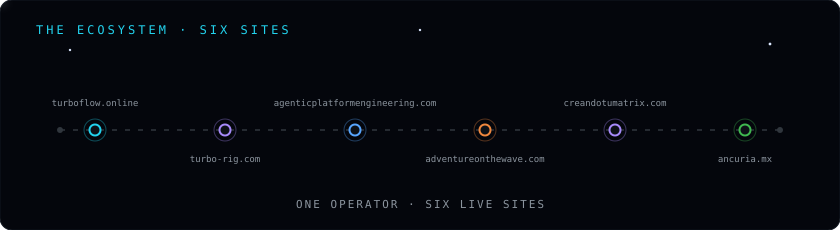

- [adventurewavelabs.space](https://www.adventurewavelabs.space) — Adventure Wave Labs: the research lab behind Turbo Flow and Turbo Rig, with its labs, initiatives, and repos
- [turboflow.online](https://www.turboflow.online) — Turbo Flow: the developer tool / rules layer for AI-written code (open source, bilingual EN/ES)
- [turbo-rig.com](https://turbo-rig.com) — Turbo Rig: the DevOps tool for AI coding agents — cross-model review gate, fail-closed verdicts, human-held merges
- [agenticplatformengineering.com](https://www.agenticplatformengineering.com) — the practice of running agentic platforms in production: sense-think-act loop, golden paths, agent-native IDP
- [adventureonthewave.com](https://www.adventureonthewave.com) — consulting: paid agentic AI & platform engineering sessions
- [creandotumatrix.com](https://creandotumatrix.com) — LATAM affiliate: AI governance and production operation, en español
- [ancuria.mx](https://ancuria.mx) — the intelligent real-estate network for Puerto Vallarta and Riviera Nayarit: listings, MLS comparison, and city rental market data

---

## Technical Reviews

Technical reviewer for [Packt Publishing](https://www.packtpub.com) since 2021 — seven titles, two credited in print. Most recent: *Operational AI with Docker* (2026), *Microsoft Foundry in Action* (2026), *Claude Beyond the Prompt* (Oct 2026, credited), and *Loop Engineering with Claude Code* (2026).

Full list → [packt-technical-reviews](https://marcuspat.github.io/packt-technical-reviews/)

---

## Read the numbers correctly

| Signal | What it measures | What it does not prove |
|---|---|---|
| Stars | Attention | Installs, retention, or production use |
| Crate downloads | Install events | Unique users — CI runs and reinstalls are counted |
| Demo GIFs | A real run of the workload shown | Anything beyond that workload |
| *Private repo — beta* badges | Honest current status | Shipping software, yet |

Every demo GIF on this page is a recording of a real run — the turbo-flow install, the netrain packet log, the Ancuria user tour — not a mockup. Star and download counts are live shields, not curated claims. Repo links and the pinned set verified against the GitHub API **October 26, 2026 UTC**.

---

## Organizations

  

| Org | Focus |
|---|---|
| [adventurewave-labs](https://github.com/adventurewave-labs) | Open-source developer tooling for the Claude and agentic AI ecosystem — the lab behind turbo-flow |
| [creandotumatrix-labs](https://github.com/creandotumatrix-labs) | Agentic AI engineering and cloud-native solutions for Latin America |

---

`Rust` · `Python` · `Shell` · `Kubernetes` · `Terraform` · `ArgoCD` · `AWS` · `GCP` · `Azure` · `Claude Code` · `SPARC`

📧 marcus@adventureonthewave.com · [LinkedIn](https://linkedin.com/in/marcuspatman) · [marcuspatman.space](https://marcuspatman.space) · [X @marcuspat](https://x.com/marcuspat) · [YouTube @marcuspatmanagentics](https://youtube.com/@marcuspatmanagentics)
